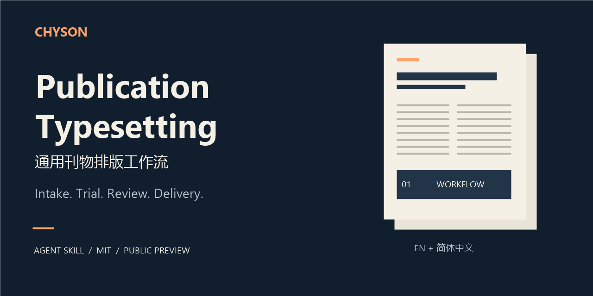

# Publication Typesetting · 通用刊物排版

**CHYSON 智恩讯信维护的刊物排版 Agent Skill。**

[English](README.md) · 简体中文 · [安装](docs/INSTALL.md) · [验证范围](VALIDATION.md) · [MIT 许可](LICENSE)

把接稿、刊物配置、代表稿试排、获准软件操作、修订审校和交付组织成可复用流程，适用于杂志、期刊等编辑排版任务。

**v0.1.0-preview。** 对外说明提供英文和简体中文，技能指令及详细参考目前以简体中文编写。现有实际演示是两页中文合成稿；英文排版、多语言生产和第二种真实刊物仍待验证。[查看准确范围](VALIDATION.md)。

## 选择入口

| 您的需要 | 入口 |
| --- | --- |
| 在自己的智能体和合法软件环境中使用 | [安装与首次试排](docs/INSTALL.md) |
| 先看自编示例和复现条件 | [两页合成演示](examples/indesign/README.md) |
| 报告问题或自愿评价 | [反馈说明](FEEDBACK.md) |
| 咨询付费试排、排版制作、配置或培训 | [联系智恩讯信](https://chyson.cn/contact/) |

咨询先说明稿件语言、预计页数、图片／表格情况、目标格式和交期。是否承接、范围、费用与交付时间逐项确认；发送稿件前先约定私密且获准的接收通道，不要将稿件放入公开 Issues。

## 包含内容

- [通用技能](skills/publication-typesetting/SKILL.md)：接稿、试排、修订、审校和交付。
- 空白刊物配置、委托记录和编辑审阅记录，不继承任何客户的字体或版式。
- 串栏跨页、图文、修订影响及多用途输出的参考方法。
- Python 标准库建档工具、只读包完整性核验工具。
- 自编中文正文、InDesign JSX 示例和两张预览图。

使用者仍需智能体宿主、合法软件与字体、可用且获准的应用控制通道。技能不会自动安装软件或获得桌面控制。参考中列出某条软件路线，不代表所有设备、版本和功能均已验证。

## 快速开始

1. 从 [Release](https://github.com/davidnyang/publication-typesetting/releases/tag/v0.1.0-preview) 下载 ZIP。
2. 审阅文件和[安装说明](docs/INSTALL.md)，按宿主要求安装完整的 `skills/publication-typesetting` 目录。
3. 确认技能被发现，核对软件、字体、控制权限和独立输出目录。
4. 用完整的合成或获准代表稿试排，再根据试排结果确认整项委托。

示例委托：

> 使用 publication-typesetting，在我授权的新工作目录中，对提供的完整文章做代表稿试排。先确认刊物配置、本机软件和实际控制通道，保留原件，检查串栏跨页和溢文，保存关闭重开原生文件，并核对导出的 PDF。缺少的证据和未执行步骤请明确登记。

## 合成演示与验证

  
  

留白用于观察文字续排、原生保存重开和 PDF 回读。这是流程演示，不是成品杂志设计或客户案例。[复现说明](examples/indesign/README.md)。

| 项目 | 本预览的证据 |
| --- | --- |
| 应用实测 | 单台 Windows，InDesign 21.0.0.192，两页自编 A4 稿 |
| 文字核对 | 原生含分隔 919 字符；PDF 正文规范空白后 910 字符，10 段齐全 |
| 技能与详细参考 | 简体中文 |
| 对外说明 | 英文、简体中文；翻译不等于相应语言排版通过 |
| 其他宿主、版本和操作系统 | 本次发布未验证 |
| 真实新刊、印厂或客户终验 | 合成演示不提供这些结论 |

[验证说明](VALIDATION.md)保留首次提取失败、修正方法及未执行项。公开包不含 INDD、嵌入字体 PDF、字体文件或应用安装程序。

## 反馈、升级与许可

[提交问题](https://github.com/davidnyang/publication-typesetting/issues/new/choose)请使用合成或公开材料，说明版本、环境、步骤和预期／实际结果；不上传客户稿件、个人信息、凭据、私有路径或完整日志。主观评分不能抵消漏文等技术失败。

升级使用版本 Release 与[更新日志](CHANGELOG.md)，先审阅差异并验证副本，再替换生产安装。本包无自动升级服务或内置遥测；所含脚本不联网，宿主本身的数据处理与权限另行核对。

自有代码、工作流文字、空白模板和合成示例采用 [MIT 许可](LICENSE)，允许使用、修改、商用和再分发，须保留相应声明。第三方软件与字体不随包提供，仍适用原许可；不代表厂商背书。定制排版、部署、培训和维护服务另行约定。

维护者：**CHYSON／智恩讯信**。[贡献说明](CONTRIBUTING.md) · [反馈](FEEDBACK.md) · [业务咨询](https://chyson.cn/contact/)
