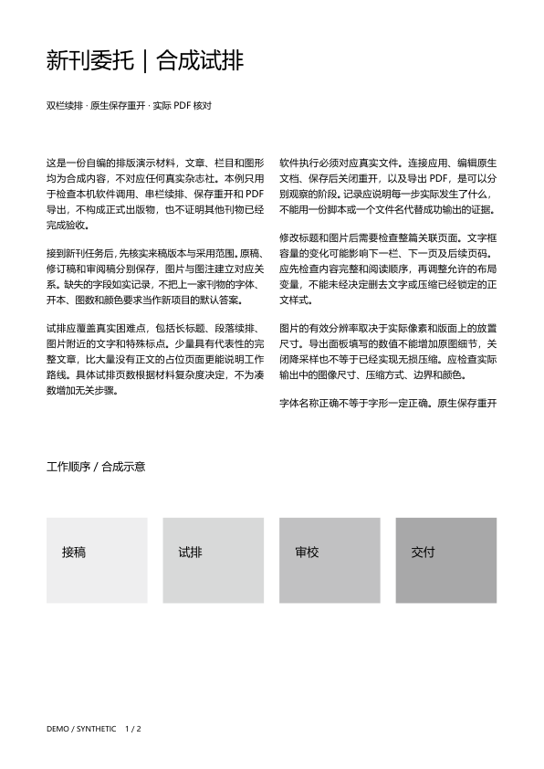
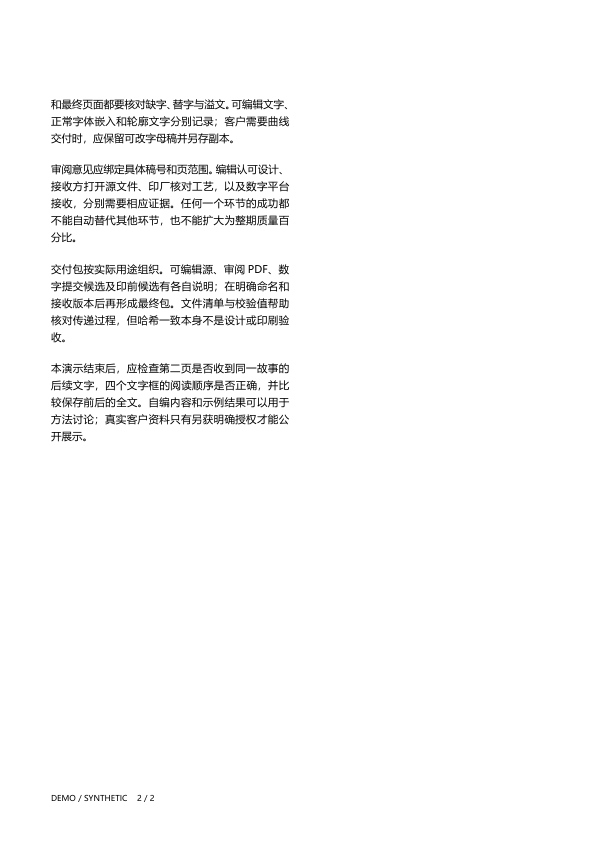

# Two-page synthetic InDesign demonstration

[English overview](../../README.md) · [中文介绍](../../README.zh-CN.md) · [Validation](../../VALIDATION.md)

The text and rectangle graphics are self-authored. The second page deliberately leaves space to inspect story continuation. This is not a finished magazine design or client sample. The package contains no font files, client material, generated INDD or embedded-font PDF.

## Reproduce in an authorized environment

Requires a working, authorized InDesign JSX channel, an available Microsoft YaHei Regular font and a new absolute output directory with an existing parent. InDesign 21.0.0.192 was exercised; other versions were not. The script exits if the font is missing or the output directory exists, and makes no network calls.

Review [native-demo.jsx](native-demo.jsx). Through your host's authorized JSX channel, set the string variable `PUBLICATION_DEMO_OUTPUT` to the new absolute directory, then execute the script. Keep outputs outside this package. Test a new environment without important unsaved documents open.

Outputs: `synthetic-trial.indd`, `synthetic-trial.pdf`, `synthetic-source.txt` and `receipt.json`. After checking `receipt.ok`, open the actual outputs and verify text in story-frame order, continuation, fonts and appearance. A successful script is not print acceptance. After a timeout, inspect the task and any ongoing writes before retrying.

A host-specific application launcher is not distributed. Confirm your own legal control channel. The script attempts to restore changed settings on normal completion and caught main-flow errors, but inherits other host PDF preferences. Restoration is not guaranteed if host cleanup or document closing fails; fault injection was not tested. Identical bytes across machines are not promised. External photos and image links were not tested.

---

# 原生两页合成演示

文字和矩形图形均为自编；第二页有意留下空间，用来验证故事续排，不用作设计质量范本。来源见[自编正文](synthetic-source.txt)。本包不含字体文件、客户材料、生成的INDD或含嵌入字体的PDF。

## 复现

需要获准控制的InDesign脚本环境、可用Microsoft YaHei Regular字体与新输出目录。实际版本21.0.0.192通过；其他版本未验。脚本在字体缺失或输出目录已存在时退出，不安装字体、不联网。

先审阅[native-demo.jsx](native-demo.jsx)。通过宿主的已获准JSX通道设置字符串变量`PUBLICATION_DEMO_OUTPUT`为新目录的绝对路径，再执行脚本。父目录须预先存在。不要把工作输出放进本候选目录，也不要在正在处理重要未保存文档时试新环境。

输出：synthetic-trial.indd、synthetic-trial.pdf、synthetic-source.txt、receipt.json。核receipt.ok后仍需打开输出，按正文框阅读顺序核文字、跨页、字体与视觉。脚本成功不等于印前通过。若调用超时先查任务及文件是否仍在写入，不要盲目重试。

说明只规定调用契约，不附与某用户电脑绑定的COM启动器。由当前宿主确认合法通道；没有通道时记录缺口而非假称执行。脚本在正常完成或捕获到主流程错误时尝试恢复改动的设置；宿主清理或关闭文档异常时不保证恢复，未做故障注入测试。其他PDF偏好沿用宿主，故不能承诺异机字节一致。没有照片/图链测试。
